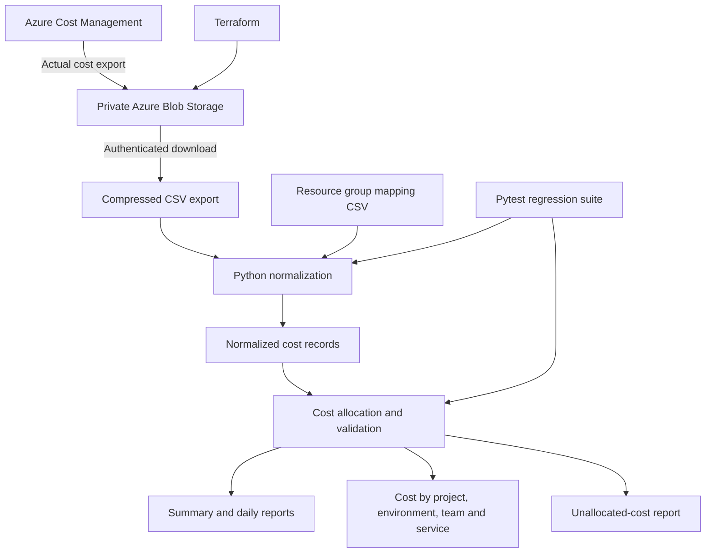

# Azure FinOps & Automated Cost Governance

[](https://github.com/georgelolu/azure-finops-cost-governance/actions/workflows/azure-cost-export-validation.yml)

A portfolio project demonstrating Azure cloud financial operations (FinOps), cost allocation, billing-data normalization, financial reporting, infrastructure as code, and security-conscious governance.

**Current focus:** Azure Cost Management actual-cost exports, private Azure Blob Storage, Terraform-managed infrastructure, and Python-based cost allocation and reporting.

## Business problem

Cloud expenditure is difficult to govern when costs cannot be reliably attributed to projects, environments, teams, and services. Incomplete resource metadata also makes it difficult to identify ownership and act on optimization opportunities safely.

This project establishes a repeatable foundation for turning Azure billing exports into auditable, engineering-friendly cost reports.

## Architecture



### Data flow

1. Azure Cost Management generates an actual-cost export.
2. The export is delivered to a private Azure Blob Storage container.
3. An authorized operator downloads the compressed export using Microsoft Entra ID authentication.
4. A Python connector normalizes Azure billing records and applies only verified resource-group mappings and available explicit tags.
5. The reporting processor validates records and produces currency-aware allocation summaries.
6. Automated tests verify allocation, financial reconciliation, credit handling, currency separation, and allocation-coverage metrics.

## Technology stack

- **Cloud:** Microsoft Azure
- **Cost data:** Azure Cost Management actual-cost exports
- **Storage:** Azure Blob Storage
- **Infrastructure as code:** Terraform
- **Authentication:** Azure CLI and Microsoft Entra ID
- **Processing:** Python, Pandas
- **Testing:** Pytest
- **Source control and delivery foundation:** Git and GitHub

Grafana dashboards, OpenCost, anomaly detection, budgets, and automated remediation are roadmap items unless separately implemented and evidenced.

## Implemented capabilities

- Ingests compressed Azure Cost Management CSV exports.
- Normalizes Azure billing records into a consistent reporting format.
- Uses explicit billing-row tags and a reviewed resource-group mapping file for attribution.
- Avoids assuming that a resource-group name automatically proves project ownership.
- Produces cost summaries by currency, project, environment, team, and service.
- Generates daily cost reports and a separate unallocated-cost report.
- Preserves negative cost adjustments and credits.
- Keeps different currencies separate rather than adding unlike currencies together.
- Reports allocation coverage independently for each dimension.
- Includes regression tests for valid inputs, invalid dates, missing fields, mappings, credits, and mixed currencies.

## Repository layout

```text
.
├── config/
│   └── resource_group_mapping.csv
├── data/
│   ├── sample/
│   │   └── costs.csv
│   └── processed/          # Generated output; ignored by Git
├── reports/
│   └── monthly/            # Reserved for report artifacts
├── src/
│   └── finops/
│       ├── allocate_costs.py
│       └── connectors/
│           └── azure_cost_export.py
├── terraform/              # Azure infrastructure definitions
├── tests/
├── requirements.txt
└── README.md
```

## Prerequisites

- Python and `pip`
- Git
- Azure CLI
- An Azure subscription with appropriate Cost Management export permissions
- Appropriate Azure Storage data-plane permissions to read the export container
- Terraform, if managing or modifying the Azure infrastructure

Use the least-privilege permissions required by your organization. Export creation permissions and Blob Storage read permissions are separate concerns.

## Run locally

### 1. Create and activate the Python environment

```bash
cd ~/azure-finops-cost-governance

python3 -m venv .venv
source .venv/bin/activate

python -m pip install --upgrade pip
pip install -r requirements.txt
```

### 2. Run the automated tests

```bash
PYTHONPATH=src pytest -v
```

### 3. Generate reports from the synthetic sample dataset

```bash
PYTHONPATH=src python -m finops.allocate_costs \
  --input data/sample/costs.csv \
  --output data/processed
```

Review the generated files:

```bash
ls -lah data/processed
cat data/processed/summary.csv
```

The sample dataset is for testing and demonstration. Do not present synthetic values as actual Azure savings or production expenditure.

## Process an Azure Cost Management export

### 1. Authenticate to Azure

```bash
az login
az account show --output table
```

Confirm that the selected subscription and tenant are the intended ones.

### 2. Download the export

Use the actual blob path shown in your storage account. Example:

```bash
mkdir -p /tmp/azure-finops-inspection

az storage blob download \
  --account-name YOUR_STORAGE_ACCOUNT \
  --container-name YOUR_PRIVATE_CONTAINER \
  --name "PATH/TO/EXPORT.csv.gz" \
  --file /tmp/azure-finops-inspection/azure-cost-export.csv.gz \
  --auth-mode login \
  --overwrite true
```

Replace the placeholders with your authorized storage account, container, and actual blob path. Do not enable shared-key access merely to make the download work.

### 3. Normalize the export

```bash
PYTHONPATH=src python -m finops.connectors.azure_cost_export \
  --input /tmp/azure-finops-inspection/azure-cost-export.csv.gz \
  --output /tmp/azure-finops-inspection/normalized_azure_costs.csv \
  --mapping config/resource_group_mapping.csv
```

### 4. Generate cost-allocation reports

```bash
PYTHONPATH=src python -m finops.allocate_costs \
  --input /tmp/azure-finops-inspection/normalized_azure_costs.csv \
  --output /tmp/azure-finops-inspection/reports
```

Inspect the summary and dimension reports locally. Actual export paths, column names, and report contents should be verified against the version of the connector in the repository.

## Allocation methodology

Allocation is based on evidence, not assumptions.

- **Project:** Explicit tags or reviewed resource-group mappings.
- **Environment:** Explicit tags or verified mappings.
- **Team:** Explicit ownership evidence; otherwise left unallocated.
- **Service:** The service information present in the billing record.
- **Cost center:** Populated only when supported by available evidence.

The mapping file is a governance input and should be reviewed as resource ownership changes. Unknown or unverified ownership must remain visible instead of being silently assigned.

### Coverage metrics

The reporting pipeline measures record coverage and absolute-cost coverage independently for project, environment, team, and service.

The overall unallocated metric is stricter: a record remains unallocated if any required allocation dimension is incomplete. Consequently, overall unallocated cost can be high even when most records have a known project.

Absolute-cost coverage is useful when credits or negative adjustments are present because signed totals can otherwise make incomplete allocation appear deceptively small.

### Currency handling

Reports group costs by currency. USD, EUR, and other currencies must not be combined into a single monetary total without an explicit, documented foreign-exchange conversion policy.

## Security and governance

- Azure Storage is configured for private blob access.
- Storage account shared-key access remains disabled.
- Downloads use Azure CLI authentication with `--auth-mode login`.
- The storage account uses HTTPS/TLS and does not allow anonymous blob access.
- Terraform state, plans, local credentials, and generated reports must not be committed.
- Raw billing exports remain outside the Git repository.
- Resource discovery and remediation should be read-only or dry-run by default.
- Any future cleanup or shutdown workflow must require explicit approval, narrowly scoped permissions, audit records, and post-action verification.
- Azure budgets and alerts help notify operators; they are not hard spending caps.
- Cost exports can be delayed and may not reflect current real-time usage.

## Validation and current evidence

### Automated test and workflow evidence

- **19 automated tests passed** in the locally verified test suite.
- **GitHub Actions: PASS** — [Azure Cost Export Validation run #40181237367](https://github.com/georgelolu/azure-finops-cost-governance/actions/runs/40181237367).
- The successful run tested commit `4b2a174489a71e54568817b0ce51cef8af73ca04`.
- The workflow runs the project tests, authenticates to Azure using GitHub Actions OpenID Connect (OIDC), and validates the latest matching Azure Cost Management export.
- Export validation checks the required CSV schema, record integrity, currency fields, and export freshness. Invalid, missing, or stale exports cause validation to fail.
- Azure access uses a federated identity and container-scoped `Storage Blob Data Reader` role; no client secret is required for the workflow's OIDC login.
- The workflow is configured for daily execution and manual dispatch.

### Azure governance evidence

- Azure Cost Management budget configuration and notification thresholds are documented in [`docs/evidence/azure-budget-governance.md`](docs/evidence/azure-budget-governance.md).
- Terraform provisions the development resource group and private cost-export storage container.
- Azure export validation and reporting are designed to avoid publishing detailed billing records or totals in this repository.
- Budget thresholds are notifications, not spending caps. Actual alert delivery and cost-data timing must be verified separately.

### Evidence and limitations

- The successful workflow run is the primary evidence of automated CI validation. A green run does not, by itself, prove that budget emails were delivered or that savings were achieved.
- The project distinguishes actual Azure billing data from synthetic test data.
- Cost attribution gaps remain visible rather than being concealed by assumptions about resource ownership.
- No savings percentage is claimed without a documented baseline, measurement window, calculation method, and supporting evidence.

## Roadmap

- [x] Add Azure budget thresholds and alert evidence.
- [ ] Add cost-anomaly detection with documented evaluation criteria.
- [ ] Add safe idle-resource discovery and dry-run recommendations.
- [ ] Add approved, auditable nonproduction shutdown workflows.
- [ ] Add Kubernetes allocation and rightsizing with OpenCost where appropriate.
- [ ] Add a Grafana dashboard and cost-per-request metrics.
- [x] Add GitHub Actions for automated tests and export validation.
- [ ] Publish redacted architecture and test evidence.
- [ ] Measure optimization outcomes against a documented baseline before claiming savings.

## Responsible reporting

Actual cost, estimated savings, simulated savings, and verified savings are different measures. Any future savings claim should include its baseline, measurement window, calculation method, and evidence. No savings percentage is claimed by this implementation.

## License

Add a license before distributing or reusing this project publicly.
